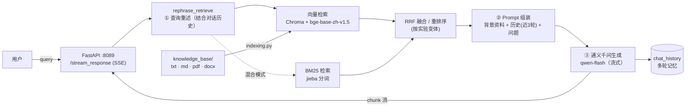

# 智能客服 RAG 问答系统（法律知识库 Demo）

基于 **LangChain + Chroma + 通义千问（DashScope）** 的检索增强生成（RAG）系统，以《民法典》类法律文档为知识库，实现多轮对话、查询重述、多路检索与流式输出，并提供一套**检索优化实验**与 **RAGAS 质量评估**体系。

> 仓库不含任何密钥与模型权重：`.env` 已被 `.gitignore` 排除，克隆后按 [快速开始](#-快速开始) 配置即可运行。

---

## 一、整体架构



流水线核心三步（对应 `retrieve.py`）：

| 步骤 | 函数 | 说明 |
|------|------|------|
| ① 查询重述 | `rephrase_retrieve()` | 用 LLM 结合近 3 轮对话历史，把「那要是被损毁了呢」这类**指代性追问**改写为独立完整的问题，再拿去检索 |
| ② 检索 | `get_retriever()` | Chroma 相似度检索，召回 Top-K（默认 k=3） |
| ③ 生成 | `get_rag_chain()` | LCEL 链：`背景资料 + 历史 + 问题 → Prompt → LLM → StrOutputParser`，无法回答时按指令回复"我不知道" |

## 二、目录结构

```
rag_demo/
├── rag.py                  # 【入口1】CLI 多轮对话（异步流式，基线链路 retrieve.py）
├── main.py                 # 【入口2】同一链路的同步版本（教学对照）
├── app.py                  # 【入口3】FastAPI Web 服务（SSE 流式，默认接 rag_eval_cache 变体）
├── templates/
│   └── naive_index.html    # Web 聊天页面
├── indexing.py             # 索引构建：加载4种格式 → 清洗 → 切分 → 向量化 → Chroma
├── retrieve.py             # 基线 RAG：重述 + 向量检索 + 生成
├── retrieve_tuning_*.py    # 检索优化实验（见下表）
├── retrieve_cache_1.py     # 检索缓存优化：query 向量 LRU 缓存（FAISS 内存索引, 512条, lru_cache 嵌入）
├── rag_eval.py             # RAGAS 质量评估（接混合检索 hy 变体）
├── rag_eval_cache.py       # 接缓存变体的运行入口（供 app.py 使用）
├── demo_index.ipynb        # 教学笔记：索引构建过程演示
├── demo_retrieve.ipynb     # 教学笔记：检索过程演示
├── demo_generator.ipynb    # 教学笔记：LLM 生成演示
├── knowledge_base/         # 知识库源文档（同一文档的 4 种格式，用于演示多格式加载）
├── vectorstore/            # Chroma 向量库（产物，不入库；indexing.py 重建，当前 564 chunks）
├── bge-base-zh-v1.5/       # 嵌入模型（不入库，需下载）
├── bge-reranker-base/      # 重排模型（不入库，仅 after_2 重排实验需要）
├── .env.example            # 环境变量模板（复制为 .env 填入真实 key）
└── 依赖安装.txt            # pip 安装命令
```

## 三、快速开始

**环境要求**：Python 3.12、CUDA（可选，无 GPU 自动用 CPU）、阿里云百炼账号

```bash
# 1. 安装依赖
pip install -r 依赖安装.txt对应命令

# 2. 配置密钥（.env 不会入库）
cp .env.example .env
#    编辑 .env 填入 TONGYI_API_KEY（https://bailian.console.aliyun.com/ 获取）

# 3. 下载模型到项目根目录（目录名必须一致）
#    - BAAI/bge-base-zh-v1.5   → ./bge-base-zh-v1.5   （必需）
#    - BAAI/bge-reranker-base  → ./bge-reranker-base  （仅重排实验需要）
#    可从 HuggingFace 或 hf-mirror.com 下载

# 4. 构建向量索引（首次必须执行；之后换知识库文档时重跑）
python indexing.py

# 5. 运行
python rag.py        # CLI 多轮对话（两个示例问题演示追问）
python app.py        # Web 界面：浏览器打开 http://127.0.0.1:8089
python main.py       # 同步版链路（教学对照）
python rag_eval.py   # RAGAS 质量评估（几分钟，消耗 API 额度）
```

## 四、检索优化实验矩阵

同一套问答链路，通过替换 `rag_eval.py` / `rag.py` 顶部的 import 切换检索策略，横向对比效果：

| 变体 | 策略 | 核心思路 |
|------|------|---------|
| `retrieve.py` | **基线**：向量检索 | 重述 → 单路向量召回 |
| `retrieve_tuning_before_1.py` | 多查询 | LLM 把问题改写出多个变体，分别检索后合并 |
| `retrieve_tuning_before_2.py` | HyDE | LLM 先生成"假设答案文档"，用它的向量去检索（弥合问答语义差） |
| `retrieve_tuning_after_1.py` | 多查询 + RRF | 多路检索结果用倒数排序融合（RRF, k=60）合并 |
| `retrieve_tuning_after_2.py` | 多查询 + RRF + 重排 | 融合后再用 `bge-reranker-base` 精排，取 Top-N |
| `retrieve_tuning_hy.py` | **混合检索** | 向量（语义）+ BM25/jieba（关键词）双路召回 + RRF 融合 |
| `retrieve_cache_1.py` | 检索缓存 | query 向量化 + 检索结果 LRU 缓存（FAISS 近邻命中），重复/相似问题零检索开销 |

## 五、RAGAS 质量评估（rag_eval.py）

对 2 轮真实多轮对话（原始问题 + 追问）执行 4 指标评估：

| 指标 | 评估环节 | 度量内容 |
|------|---------|---------|
| `nv_context_relevance` | 检索（精度） | 检回资料中真正对题的比例，惩罚噪音 |
| `answer_relevancy` | 生成 | 答案与问题的贴合度，惩罚答非所问/内容注水 |
| `faithfulness` | 生成（反幻觉） | 答案论断能被资料支撑的比例 |
| `nv_response_groundedness` | 生成 | 回答是否整体立足检索资料 |

**参考结果**（qwen-flash 生成 + 同模型裁判，2 样本）：

```
{'nv_context_relevance': 1.0000, 'answer_relevancy': 0.6459,
 'faithfulness': 0.9000, 'nv_response_groundedness': 1.0000}
```

**解读要点**：
- 检索干净（1.0）、基本无幻觉（0.9+/1.0），短板在 `answer_relevancy`（0.65）——模型爱附加资料之外的一般性建议（取证、诉讼途径等），可在 Prompt 中收紧；
- `context_relevance` 只度量**精度**不度量**召回**——目标条文掉出 Top-K 时该值仍可能为 1.0，验证召回需引入 `context_recall`（需人工标注）；
- 样本量 2 仅够看方向，正式评估建议 ≥20 条 query，且裁判模型与生成模型分离。

## 六、配置说明（.env）

| 变量 | 必填 | 说明 |
|------|------|------|
| `TONGYI_API_KEY` | ✅ | 阿里云百炼 DashScope API Key |
| `TONGYI_MODEL` | ❌ | 生成模型，默认 `qwen-flash`；全部入口统一读取此变量，换模型只改这一行 |

## 七、FAQ（踩坑记录）

| 现象 | 原因 | 解决 |
|------|------|------|
| `UnicodeEncodeError: 'latin-1' codec...` | `.env` 里 key 含中文/占位符，拼进 HTTP 头无法编码 | 填入真实的 `sk-` 开头 key |
| `429 Throttling.RateQuota` | 部分账号 `qwen-turbo` 限流为 0（免费额度未领取/过期），`qwen-flash`/`qwen-plus` 不受影响 | `.env` 用 `TONGYI_MODEL=qwen-flash`，或在百炼控制台领取对应模型额度 |
| ragas 报 `No module named 'langchain_community.chat_models.vertexai'` | ragas 0.3.x 硬导入该模块，而 langchain-community ≥0.4 已删除 | 锁定 `langchain-community==0.3.29`（详见依赖安装.txt），**不要**升级 langchain 全家到 1.x/0.4.x |
| 索引时 `PDFPageCountError: Unable to get page count` | PDF `hi_res` 策略依赖系统级 Poppler（Windows 未装） | `indexing.py` 已改用 `fast` 策略（纯文本提取）；扫描版 PDF 才需装 Poppler |
| NumPy 1.x/2.x 兼容性警告刷屏 | 环境中 numpy 被升到 2.x，与旧编译的 pandas/numexpr 不兼容 | `pip install "numpy<2"` |
| `langchain.text_splitter` 导入失败 | langchain 1.x 移除该路径 | 使用 `langchain_text_splitters`（已修复） |
| 答案的「背景资料」为空 | 向量库未构建（从未运行 indexing.py） | 运行 `python indexing.py` |

## 八、核心依赖版本

| 包 | 版本 | 说明 |
|----|------|------|
| langchain-community | 0.3.29 | **勿升级**，与 ragas 0.3.x 强绑定 |
| langchain-core | 0.3.x | 随 community 联动降级 |
| langchain-chroma | 0.2.5 | 向量库集成 |
| langchain-huggingface | 0.3.1 | 本地嵌入模型 |
| langchain-openai | 0.3.32 | ragas 间接依赖 |
| ragas | 0.3.6 | 评估框架（0.4.x 仍存在 vertexai 导入问题） |
| chromadb | 1.5.x | 向量数据库（Rust 内核，单文件持久化） |
| dashscope | 1.24.x | 通义千问 SDK |
| numpy | 1.26.4 | `<2` |

---

*项目来自尚硅谷大模型课程「智能客服系统」实战模块，检索优化与评估体系部分为个人扩展实验。*
